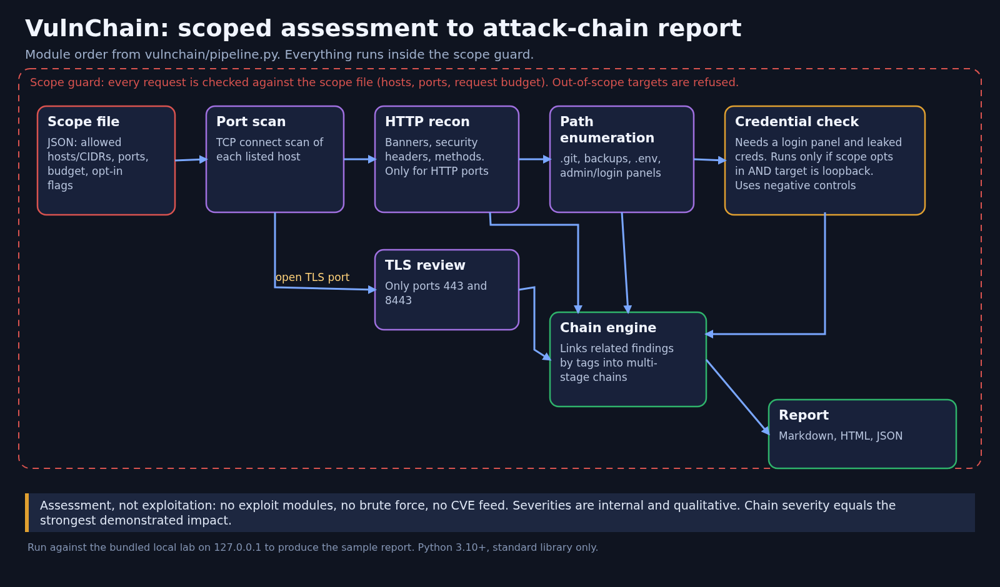
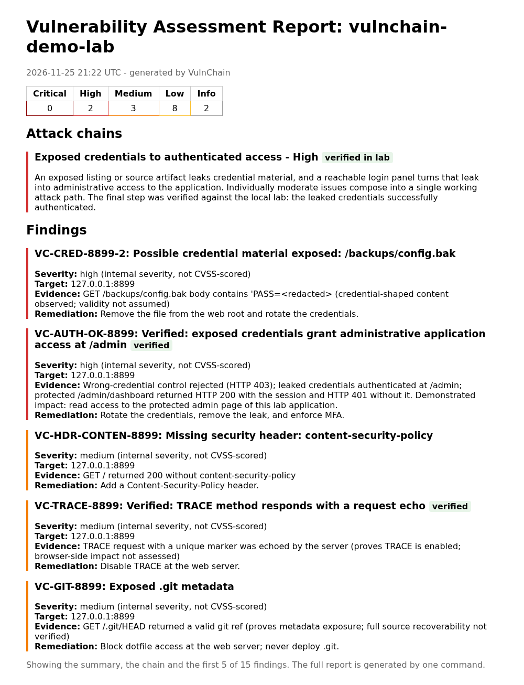

# VulnChain

Authorized-scope vulnerability assessment with **attack-chain correlation** and
one-command VAPT reporting.

Most scanners produce a flat list of findings. Real compromises rarely come
from one big vulnerability - they come from several moderate weaknesses that
feed each other. VulnChain assesses a target inside a strict authorized scope,
then **links related findings into attack chains** and reports them together, so a "medium" directory listing plus a "high" credential leak plus a
login panel is shown as what it actually is: one provable path in. The chain's severity is the strongest demonstrated impact in it (no automatic amplification).

Everything ships with a **local demo lab** so the whole pipeline, including a
verified credential-to-admin chain, runs against 127.0.0.1 with zero risk.



## Features

- **Hard scope enforcement** - every request is checked against a scope file
  (hosts/CIDRs + ports + request budget). Out-of-scope targets are refused,
  not just warned about.
- **Assessment modules** - TCP connect port discovery, HTTP recon (banners,
  security headers, dangerous methods), directory/sensitive-file enumeration
  (`.git`, backups, `.env`, panels), TLS review (certificate, legacy protocols).
- **Attack-chain engine** - correlates findings by tags into multi-stage
  chains. Chain severity is internal and equals the strongest demonstrated
  impact; the narrative explains how the weaknesses compose, with no
  automatic amplification.
- **Control-backed verification** - when (and only when) the scope opts in *and*
  the target is loopback, leaked credentials are tried against a discovered login
  panel with negative controls (wrong credentials must fail, protected page must
  reject anonymous access) plus a session-based proof of the protected resource.
  Only then is a chain marked verified.
- **Honest scoring** - severities are internal and qualitative by default:
  nothing gets a numeric CVSS score from a hardcoded template. A tested CVSS
  3.1 calculator is included for the tester to score engagement-specific,
  demonstrated impact. Methods are labeled "advertised" unless actually
  executed, "verified" items are confirmed with controls, and evidence is
  redacted so reports never leak secrets.
- **Professional VAPT reports** - Markdown, styled HTML and JSON: executive
  summary, methodology, chains, evidence-backed findings with CVSS base
  scores, remediation and an honest limitations section.
- **Stdlib only** - Python 3.10+, no dependencies to install.

## Quickstart (local lab)

```bash
git clone <repo-url> && cd vulnchain
python3 lab/vulnerable_app.py 8899 &        # deliberately vulnerable, loopback only
python3 -m vulnchain --scope scope.example.json --out reports/
```

Open `reports/vapt-report.html` (excerpt below). You get findings across severity levels and
one **verified high-severity chain**: directory listing -> leaked `config.bak`
credentials -> `/admin` panel -> session-proven admin access (wrong-credential
and anonymous-access controls checked first).



Run the tests:

```bash
python3 -m unittest discover -s tests -v
```

## Using it on a real target

You must have **explicit written authorization** for every host in your scope
file. Create your own scope:

```json
{
  "name": "client-engagement-2026-11",
  "allowed_hosts": ["10.0.0.15", "app.client.example"],
  "allowed_ports": [80, 443, 8080],
  "verify_credentials": false,
  "max_requests_per_host": 200
}
```

`verify_credentials` only ever fires against loopback lab targets; it cannot
be used against real hosts.

## Methodology

See [METHODOLOGY.md](METHODOLOGY.md). Phases: scope validation, discovery,
reconnaissance, enumeration, TLS review, optional lab-only verification,
chain correlation, reporting. Findings carry an internal qualitative severity and are not CVSS-scored (a CVSS 3.1
calculator ships for the tester to score a demonstrated impact); chain severity equals the strongest demonstrated impact in the chain, so
standalone severity and chained impact stay visibly separate.

## Honest limitations

- Assessment, not exploitation: no exploit modules, no privilege escalation,
  no brute force. Those phases stay manual and authorization-bound.
- No CVE feed: version disclosures are not matched to known exploits.
- The port scanner is a TCP connect scanner (no SYN scan, no UDP).
- The directory wordlist is intentionally small and high-signal.
- Banner findings reflect what the target presents; labs and honeypots can
  simulate banners (the bundled lab does exactly that).
- Results reflect the target at test time only.

## Legal / ethics

VulnChain is for authorized security testing and education. Running it against
systems without explicit permission is illegal in most jurisdictions and is
refused by the scope guard but ultimately **your** responsibility. The bundled
lab exists so you can learn without touching anyone else's systems.

## License

MIT - see [LICENSE](LICENSE).
